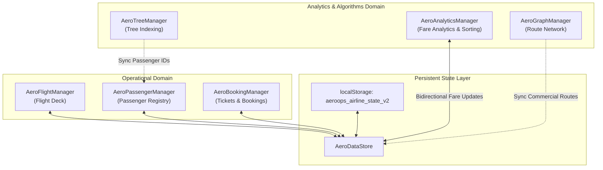

# AEROOPS — Architecture & Module Dependency Map

This document outlines the software architecture, module communication patterns, and data flow for the **AEROOPS — Airline Reservation & Flight Network Suite**.

---

## 1. High-Level Architecture

AEROOPS is structured as a decoupled, event-driven client-side application built with modular vanilla JavaScript (ES6+), HTML5, and CSS3.

```
                    ┌──────────────────────────────────────────────┐
                    │               User Interface                 │
                    │        (index.html & Twilight Runway)        │
                    └──────────────────────┬───────────────────────┘
                                           │
         ┌─────────────────────────────────┼─────────────────────────────────┐
         │                                 │                                 │
         ▼                                 ▼                                 ▼
┌──────────────────┐             ┌───────────────────┐             ┌───────────────────┐
│ Operational UI   │             │ Algorithm Studios │             │ UI Subsystems     │
│ - Flight Deck    │             │ - Route Network   │             │ - Modal System    │
│ - Passengers     │             │ - Tree Indexing   │             │ - Toast Manager   │
│ - Bookings       │             │ - Fare Analytics  │             │ - Navigation/Tabs │
└────────┬─────────┘             └─────────┬─────────┘             └───────────────────┘
         │                                 │
         │         Event Bus / Pub-Sub     │
         └────────────────►◄───────────────┘
                           │
                           ▼
         ┌───────────────────────────────────┐
         │          AeroDataStore            │
         │  (State Manager & LocalStorage)   │
         └─────────────────┬─────────────────┘
                           │
                           ▼
         ┌───────────────────────────────────┐
         │         Browser Storage           │
         │   `aeroops_airline_state_v2`      │
         └───────────────────────────────────┘
```

---

## 2. Module Directory Structure & Responsibilities

### Core & Framework
* **`index.html`:** Semantic HTML5 cockpit application shell. Hosts all 5 view panels, modal dialogs, KPI counters, and telemetry consoles.
* **`css/design-tokens.css`:** Design token dictionary containing CSS Custom Properties (`--color-bg-base`, `--color-accent`, `--font-mono`, `--space-*`, `--radius-*`).
* **`css/main.css`:** Cockpit UI layouts, data tables, SVG visualizers, animated sorting bar charts, and responsive media queries.
* **`js/app.js`:** Application coordinator. Manages view switching (`switchView`), W3C ARIA tab keyboard navigation, UTC telemetry clock, and module initialization.

### Operational Domain (`service` & `model` Java Mirrors)
* **`js/airline-data.js` (`AeroDataStore`):**
  * Centralized single source of truth for flights, passengers, and bookings.
  * Provides schema migration, relational integrity enforcement, and LocalStorage persistence.
  * Dispatches mutation events (`ADD_FLIGHT`, `UPDATE_FLIGHT`, `DELETE_FLIGHT`, `ADD_PASSENGER`, `BOOK_TICKET`, etc.) through an internal pub-sub event bus.
* **`js/flight-manager.js` (`AeroFlightManager`):**
  * Controls `#view-flight-deck`.
  * Manages search filtering, airline sorting, fare adjustment modal (`#modal-fare`), and flight scheduling (`#modal-flight`).
* **`js/passenger-manager.js` (`AeroPassengerManager`):**
  * Controls passenger manifests, demographic telemetry KPIs, and passenger registration (`#modal-passenger`).
* **`js/booking-manager.js` (`AeroBookingManager`):**
  * Controls ticket bookings (`#modal-booking`), cancellation with confirmation guards, and thermal boarding pass rendering (`#modal-boarding-pass`).

### Route Network & Graph Optimization (`graphs` Java Mirror)
* **`js/graph/graph-data.js` (`AeroGraphData`):**
  * Maintains airport hub vertex metadata (coordinates, names, cities) and national air corridor edges.
  * Supports dynamic route additions, weight updates, and route synchronization from active fleet flights.
* **`js/graph/graph-algorithms.js` (`AeroGraphAlgorithms`):**
  * 7 pure algorithmic engines: BFS, DFS, Dijkstra, Bellman-Ford, Prim MST, Kruskal MST, and Floyd-Warshall.
  * Records step-by-step traces for interactive visualization.
* **`js/graph/graph-visualizer.js` (`AeroGraphVisualizer`):**
  * Responsive SVG graph renderer. Renders airport hubs, bidirectional corridor lines, distance labels, and animated pulse highlights.
* **`js/graph/graph-manager.js` (`AeroGraphManager`):**
  * Orchestrates graph algorithm execution, playback timing, and the all-pairs Floyd-Warshall matrix inspector.

### Database Indexing & Trees (`tree` Java Mirror)
* **`js/trees/tree-data.js` (`AeroTreeData`):**
  * Standard and rotation-triggering test datasets.
  * Extracts passenger ID keys from `AeroDataStore` for live manifest indexing.
* **`js/trees/bst.js` (`AeroBST`):**
  * Binary Search Tree implementation with search paths and recursive traversals.
* **`js/trees/avl-tree.js` (`AeroAVLTree`):**
  * Self-balancing AVL Tree supporting LL (Right), RR (Left), LR, and RL double rotations.
* **`js/trees/b-tree.js` (`AeroBTree`):**
  * B-Tree of degree $t=3$. Splits full nodes (5 keys) into 2-key children while promoting median keys.
* **`js/trees/b-plus-tree.js` (`AeroBPlusTree`):**
  * B+ Tree ($t=3$) featuring index router nodes, leaf data replication, and sequential horizontal leaf links (`leaf.next`).
* **`js/trees/tree-visualizer.js` (`AeroTreeVisualizer`):**
  * Responsive SVG tree layout engine. Dynamically recalculates node positions level-by-level with smooth animated SVG transitions.
* **`js/trees/tree-manager.js` (`AeroTreeManager`):**
  * Manages active tree selection, insertions, searches, traversals, and execution telemetry logging.

### Fare Analytics & Sorting (`sorting` & Range Tree Java Mirrors)
* **`js/analytics/fare-data.js` (`AeroFareData`):**
  * Interfaces with fleet flights and generates deterministic benchmark fare vectors (random, sorted, reverse, duplicates, mountain).
* **`js/analytics/segment-tree.js` (`AeroSegmentTree`):**
  * $4N$ binary interval tree for Range Minimum Queries (RMQ) with point update propagation.
* **`js/analytics/fenwick-tree.js` (`AeroFenwickTree`):**
  * 1-based Binary Indexed Tree (BIT) for prefix sums and Range Sum Queries (RSQ) via bitwise LSB operations: `index & (-index)`.
* **`js/analytics/sorting-algorithms.js` (`AeroSortingSuite`):**
  * Ports of `MergeSort.java`, `QuickSort.java`, and `HeapSort.java`.
  * Generates visual step traces without mutating input arrays.
  * Includes head-to-head synchronous benchmark runner.
* **`js/analytics/analytics-visualizer.js` (`AeroAnalyticsVisualizer`):**
  * Renders SVG Segment Tree, dual-row Fenwick BIT blocks, and vertical animated sorting bar charts.
* **`js/analytics/analytics-manager.js` (`AeroAnalyticsManager`):**
  * Sub-tab controller (Segment RMQ, Fenwick RSQ, Sorting Lab), unified playback engine, and cockpit telemetry terminal.

---

## 3. Data Flow & Cross-Module Synchronization



### Key Synchronization Invariants:
1. **Fare Updates:** Updating a flight fare in Flight Deck automatically notifies subscribers via `AeroDataStore.notify()`. If Fare Analytics is observing fleet data, it automatically reloads and recomputes its Segment Tree and Fenwick Tree. Updating a fare in Fare Analytics updates `AeroDataStore` and reflects in Flight Deck.
2. **Passenger Keys:** Adding or deleting a passenger in Passenger Registry immediately updates `AeroDataStore.getPassengers()`, making the key available for one-click indexing in the Tree Indexing Studio.
3. **Referential Integrity:** Deleting a flight or passenger with active tickets is prevented by `AeroDataStore` deletion guards, requiring tickets to be cancelled first.
4. **Sorting Immutability:** Sorting animations operate strictly on deep clones. The persistent flight order in `AeroDataStore` is never modified by sorting visualizations.

---

## 4. Preserved Java Source Inventory & Cryptographic Parity

The original Java project source files are located in `src/`. Below are the canonical Git-blob SHA-1 hashes (from GitHub commit `cc755ec` tree) and on-disk SHA-256 hashes verifying that all 23 Java files match the original source after line-ending normalization:

| Relative Path | Canonical Git-Blob SHA-1 (`cc755ec`) | Local Raw SHA-256 | Parity Status |
| :--- | :--- | :--- | :---: |
| `src/graphs/GraphAlgorithms.java` | `687c0752f82e1a230e4eb3c640ea1bc5bdc38478` | `138ad024bb25e9e67b2f2827a933c0ec016213ec0ee001a77134945406880811` | **MATCH** |
| `src/main/AirlineReservationSystem.java` | `ed6c9ecb14134569be333aaec173eb63c5f2a88f` | `e1d370e4890a42bf61015ac0d1694227284131981b7d2298b675a2a3684cdcf8` | **MATCH** |
| `src/model/Airport.java` | `4770c53615dc7ae4c926d29acc66daf3fa660f8a` | `7b7f6d725f2b97e100acab8a0f9f2dd7acdcd87781b99ae802f965bd7c85dc03` | **MATCH** |
| `src/model/Flight.java` | `d50c2623fb455dce67c8acaf1df0228ff74cbd17` | `be17b163c09b3bea74a104f7bf0d465cd7137832792096f7bd29c5446040d7c3` | **MATCH** |
| `src/model/Passenger.java` | `56af1ad16672da5eb912b5f13243c803ce978b00` | `c28f95af73d4fc687aa017ce88503d0ca9207194a2b0a09b18602d877429d367` | **MATCH** |
| `src/model/Ticket.java` | `a2c6d1d5667f3b088c32a0096fd32117ed468c08` | `e88df371d9c64ae043410e4639ac0dc3a3836a845bec4c63499a84f1ea1a8410` | **MATCH** |
| `src/module-info.java` | `46e1284d77592d2b48015aac365f359800f36c9f` | `3225d97379d78389861682dfd728a93cc9e50926fef1b285023d811aba136da5` | **MATCH** |
| `src/service/BookingService.java` | `99a222078ccd116a1861d7c3422a071074404904` | `bc1cf1bb346c9c0ac6a21ff6720dfe69265f767eaf96c17113fcebaa02dfbdef` | **MATCH** |
| `src/service/FlightService.java` | `140b5de7ae57b29a2b16e1b3a9f639bc9c4e0f12` | `5609ff15ec5038998b129b665f6099b82a1d14eb1478a74c5d3fff07d0fd18ff` | **MATCH** |
| `src/service/PassengerService.java` | `b20e5b2271b489944fac96db8944a9fac4c9dca4` | `d8c3b0bc4af865bcc35b68329470113fc29cbf2e4aa132e463ec8720be78e0d4` | **MATCH** |
| `src/sorting/HeapSort.java` | `93e0c9a1bdc5b476817a592515a0692f33fa0a77` | `e79ddad21fb52d8044db04199754d5873264d1662f5e8eeca14df6407b448bfc` | **MATCH** |
| `src/sorting/MergeSort.java` | `994661758042a3429fb3e1396b0fb3c9d7a61f70` | `4b5838f60c367812f2e48d670e9f1e5ccd00cf98be9c487b6bcdd4303c94956f` | **MATCH** |
| `src/sorting/QuickSort.java` | `acc9db21f33974adc44ddc5938d3f0fa822617a4` | `9a4d81a7a78ab85920d74256563b6363ad1b2a36b4255b381952b431c8d44c87` | **MATCH** |
| `src/tree/AVLNode.java` | `f9c568f79b7032641b16e681eda74202cc90aa59` | `b960dc4b4df5ac1f7de81a431d86de9bac737cc463fe04e49948fe0d47ba1dae` | **MATCH** |
| `src/tree/AVLTree.java` | `c3d26e0e974d72b14c41e35f9829374e55b6fd43` | `bafe98b6882aa27c2632f581e4d87794573b2de9c16b18f6c33f13219473e225` | **MATCH** |
| `src/tree/BPlusTree.java` | `8836de7dd878a4b221b963bc5c0e6752abf23051` | `2dd0fb3c8210e28b3b25d894ab5ce80a9a6609909608c2483753e9b467ccd9e5` | **MATCH** |
| `src/tree/BPlusTreeNode.java` | `0d3f9ffecb85e490449dd130ad9fb1f22e1e912d` | `8659df6813495bab62c2d5c55da747c3f80d973bcd051b6c5f1a47e2c4c621eb` | **MATCH** |
| `src/tree/BST.java` | `6daca8b904aa7b0ae9f211cc16fab5ac77d9f438` | `0657a585fe260eda4f8cdd2fc0f13457941c0cf8ab0dd0ef99cd905d3dbff565` | **MATCH** |
| `src/tree/BSTNode.java` | `f582fd2e54f283c5e831bcacddf0b8be747ba7ad` | `8bb621eece56fe3a63b5769b27c12ed186360408e505ea0bc96af49fa18b5de0` | **MATCH** |
| `src/tree/BTree.java` | `40b75a85be587d7e78d69e2b4af05b228849ad89` | `da210c95a3d34ed4239ca8e4d2fc9aa281da58c5ec3314ce2c9224dcc2d9d547` | **MATCH** |
| `src/tree/BTreeNode.java` | `fefed36e0b143ba5adc1f64ef08ea3f9f6c8ba1c` | `2cc391a928a93a1b299d27ed0bebb5b91a01c1fdf5dadd5413d98067f6bf6a31` | **MATCH** |
| `src/tree/FenwickTree.java` | `6756e798ab15bda16844294d98b9faaaa708d3fb` | `05a64fc627d63e3dfed4285c866e27372c4122dea6f2e9005931dcd876c24a6a` | **MATCH** |
| `src/tree/SegmentTree.java` | `39933aa66fee192bae47f3711ca4ef4a4974b49c` | `38e2ea87d58cdef74c92b146fc2592b86b02c7517975dea216a26694ad577e22` | **MATCH** |
